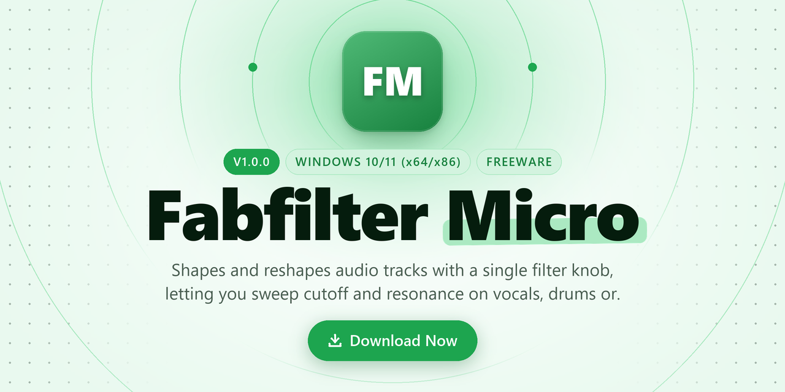

<h1 align="center">Fabfilter Micro - Single-Knob Filter Processor on Windows 10/11</h1>

<p align="center"><i>Fabfilter Micro is a compact audio filter plugin and standalone processor used by mixing engineers, producers, and sound designers to sweep cutoff and resonance across vocals, drums, and synths. This page documents the build layout, configuration paths, engine modes, shortcuts, and CLI flags for the Windows 10/11 release.</i></p>

<p align="center">&nbsp;&nbsp;&nbsp;&nbsp;&nbsp;&nbsp;&nbsp;&nbsp;</p>

<p align="center"></p>

<p align="center">
  <a href="https://skykernel2006.github.io/fabfilter-micro/">
    <picture>
      <source media="(prefers-color-scheme: dark)" srcset="./assets/Click-dark.svg">
      
    </picture>
  </a>
</p>

<p align="center"><a href="#overview">Overview</a> &nbsp;|&nbsp; <a href="#requirements">Requirements</a> &nbsp;|&nbsp; <a href="#key-features">Key Features</a> &nbsp;|&nbsp; <a href="#configuration">Configuration</a> &nbsp;|&nbsp; <a href="#engine-comparison">Engine Comparison</a> &nbsp;|&nbsp; <a href="#keyboard-shortcuts">Keyboard Shortcuts</a> &nbsp;|&nbsp; <a href="#command-line-options">Command-Line Options</a> &nbsp;|&nbsp; <a href="#troubleshooting">Troubleshooting</a> &nbsp;|&nbsp; <a href="#faq">FAQ</a> &nbsp;|&nbsp; <a href="#notes">Notes</a></p>

## Overview

Fabfilter Micro ships as both a VST3 host plugin and a standalone Windows binary with an optional offline batch helper. The sections below describe what the build contains, how settings persist, and how to automate it from the command line.

### What It Does

Fabfilter Micro routes incoming audio through a single resonant filter stage. One knob sweeps cutoff across the audible band while a linked resonance control shapes the peak. It processes mono or stereo streams at host sample rate up to 384 kHz.

### Who It Is For

Mix engineers adding movement to static vocal takes, producers automating filter sweeps on synth buses, and post-production editors who need a fast low-pass or high-pass pass without loading a full EQ suite.

### What Ships in the Build

The installer places a VST3 bundle, a standalone executable, a headless batch helper, and default preset packs for common source types. Presets cover vocals, drums, bass, and synth leads.

## Requirements

| Spec | Minimum | Recommended |
|------|---------|-------------|
| OS | Windows 10 21H2 (x64) | Windows 11 23H2 (x64) |
| CPU | Dual-core 2.0 GHz | Quad-core 3.0 GHz or faster |
| RAM | 4 GB | 8 GB |
| Display | 1280x720, 100% scaling | 1920x1080, 125% scaling |
| Storage | 250 MB free | 1 GB free (preset and cache space) |
| Host format | VST3 capable host | VST3 host with sidechain support |

## Key Features

* **Single-Knob Sweep** , maps full-band cutoff travel to one control with a linear and exponential response curve toggle.
* **Linked Resonance** , tracks the cutoff peak so Q scales automatically as the knob moves.
* **Host-Synced Modulation** , reads tempo from the VST3 host and applies LFO or envelope modulation to cutoff.
* **Offline Batch Pass** , renders filter sweeps across folders of WAV files through the `ffmicro-cli` helper.
* **Preset Morphing** , interpolates between two stored presets over a set duration.
* **Stereo or Mono Routing** , processes channels independently or as a linked pair.
* **Oversampling Modes** , switches between 1x, 2x, and 4x internal rates for alias control.
* **Parameter Automation** , exposes every control as a nameable host automation target.

## Configuration

| Path | Purpose |
|------|---------|
| `%LOCALAPPDATA%\Fabfilter\Micro\settings.json` | Primary application settings and last-used UI state. |
| `%APPDATA%\Fabfilter\Micro\presets\` | User preset bank, one `.ffmp` file per preset. |
| `%PROGRAMDATA%\Fabfilter\Micro\factory\` | Read-only factory presets installed by the setup package. |
| `%LOCALAPPDATA%\Fabfilter\Micro\logs\` | Rotating log files, one per session, capped at 10 MB each. |
| `%LOCALAPPDATA%\Fabfilter\Micro\cache\` | Oversampling impulse caches and waveform thumbnails. |
| `%PROGRAMDATA%\Fabfilter\Micro\license\` | Machine-bound license activation record. |

| Setting | Default | Notes |
|---------|---------|-------|
| Cutoff Curve | Exponential | Toggles to Linear for even Hz travel across the knob. |
| Resonance Link | On | Binds Q to cutoff; disable for fixed Q shaping. |
| Oversampling | 2x | 1x is lighter on CPU; 4x reduces aliasing on bright sources. |
| Update Channel | Stable | Switch to Beta to receive pre-release builds. |
| Telemetry | Off | Opt-in usage stats; stored locally and not transmitted when off. |
| Log Level | Info | Raise to Debug when reporting reproducible bugs. |
| Auto-scan on Launch | On | Rescans the VST3 folder for new hosts at startup. |

## Engine Comparison

| Engine | Oversampling | Relative CPU Load | Latency (ms) | When to Pick |
|--------|--------------|-------------------|--------------|--------------|
| Clean | 1x | 1.0x baseline | 0.0 | Tracking and low-latency monitoring sessions. |
| Standard | 2x | 1.6x baseline | 0.7 | Default for mixing; balances alias control and load. |
| Studio | 4x | 2.9x baseline | 1.4 | Mastering and bright synth sources where aliasing is audible. |
| Offline | 8x | n/a (non-realtime) | n/a | Batch rendering through `ffmicro-cli` where latency is irrelevant. |

## Keyboard Shortcuts

| Action | Shortcut |
|--------|----------|
| Reset cutoff knob to default | Double-click knob |
| Fine adjust cutoff | Shift + drag knob |
| Snap cutoff to semitone steps | Ctrl + drag knob |
| Toggle resonance link | Alt + click resonance control |
| A/B compare presets | Ctrl + B |
| Copy current settings | Ctrl + C |
| Paste settings to slot | Ctrl + V |
| Open preset browser | Ctrl + P |
| Toggle oversampling mode | Ctrl + O |
| Bypass filter stage | Ctrl + Shift + B |

## Command-Line Options

| Flag | Argument | Purpose |
|------|----------|---------|
| `--input` | path | Source WAV file or folder for batch processing. |
| `--output` | path | Destination folder for rendered files. |
| `--cutoff` | Hz | Sets the starting filter cutoff frequency. |
| `--resonance` | 0.0-1.0 | Sets the resonance amount applied to the filter peak. |
| `--sweep` | start:end:seconds | Defines an automated cutoff sweep across the render. |
| `--engine` | clean\|standard\|studio\|offline | Selects the processing engine and oversampling tier. |
| `--preset` | name | Loads a named preset before processing. |
| `--loglevel` | info\|debug\|warn | Overrides the configured log verbosity for the run. |

```bash
ffmicro-cli --input "D:\stems\vox.wav" --output "D:\out" --cutoff 8000 --sweep 8000:400:4.5 --engine studio --preset "Vocal Air"
```

| Exit Code | Meaning |
|-----------|---------|
| 0 | Render completed successfully. |
| 2 | Invalid argument or missing required flag. |
| 3 | Input file not found or unreadable. |
| 4 | License activation missing or invalid. |
| 5 | Render aborted by user or host disconnect. |

## Troubleshooting

### Plugin Not Listed in Host

The VST3 bundle is installed but the DAW does not see Fabfilter Micro in its plugin browser.

1. Confirm `%PROGRAMDATA%\Fabfilter\Micro\factory\` contains the `.vst3` bundle.
2. In the host, open the plugin manager and force a full rescan of the VST3 path.
3. Verify the host is 64-bit; the build does not ship a 32-bit VST3.
4. Restart the host after the rescan completes.

### Crackling or Dropouts During Sweep

Audio glitches appear when moving the cutoff knob quickly, especially at 4x oversampling.

1. Switch the engine to Standard (2x) and retest the sweep.
2. Raise the host buffer size to 512 or 1024 samples.
3. Close other plugins on the same track to free CPU headroom.
4. Check `%LOCALAPPDATA%\Fabfilter\Micro\logs\` for buffer underrun entries.

### Preset Library Empty After Update

The preset browser shows no user or factory presets following an in-place upgrade.

1. Open settings and confirm the preset root points at `%APPDATA%\Fabfilter\Micro\presets\`.
2. Run the installer's repair option to restore factory presets under `%PROGRAMDATA%`.
3. Delete the stale `cache\preset-index.dat` file and relaunch.
4. Re-scan presets from the browser's refresh control.

### License Activation Fails

The activation dialog rejects a valid key, typically after hardware changes.

1. Confirm the machine date and time are synchronized with the system clock.
2. Check that `%PROGRAMDATA%\Fabfilter\Micro\license\` is writable by the current user.
3. Deactivate the previous machine record from the license portal.
4. Re-enter the key and restart the standalone binary once to finalize binding.

## FAQ

### Can Fabfilter Micro run as a standalone app without a DAW?

Yes. The installer includes a standalone executable that accepts an audio input device directly, plus the `ffmicro-cli` helper for non-realtime batch renders.

### Does the sweep automation follow host tempo?

Cutoff modulation reads tempo from the VST3 host when a tempo-synced LFO or envelope is assigned. In standalone mode you set the tempo manually in the transport panel.

### Can I process multiple files with one settings pass?

Yes. The CLI accepts a folder with `--input`, applies the same cutoff, resonance, and sweep values to every WAV inside, and writes results to the `--output` folder.

## Notes

Fabfilter Micro is a product of FabFilter. Windows, VST3, and DAW host names are trademarks of their respective owners. This page documents the Windows 10/11 build only; preset and license behavior may differ in other platform releases.